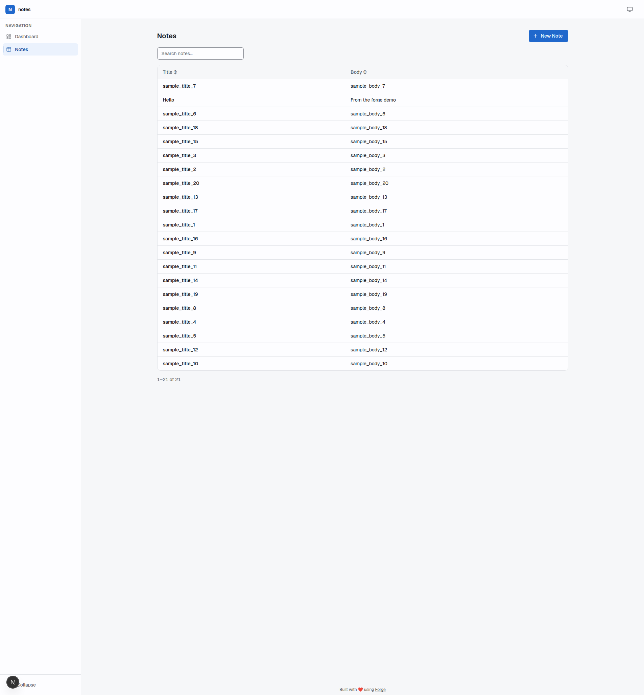

# notes: a Forge reference app

A small full-stack app made with [Forge](https://github.com/reliant-labs/forge)
(Apache-2.0): a Go Connect RPC API with one entity (`Note`) in Postgres, and a
Next.js static-export frontend that lists, creates, views and edits notes
through generated TypeScript hooks.

> **No sign-in.** This app has no authentication: anyone who can reach it can
> create and edit notes. Run it locally. Don't deploy it where the public can
> reach it without adding auth first
> ([Forge auth](https://docs.reliantlabs.io/forge/auth)).

This app lives in the `forge-notes/` directory of
[reliant-labs/examples](https://github.com/reliant-labs/examples). Run every
command below from inside `forge-notes/`, where `forge.yaml` is. From the
repository root Forge finds no project, and `forge lint` reports a pass
without checking anything.

The point of this directory is the history, not the app. Each step is its own
commit (`git log --oneline -- forge-notes`), so you can see what Forge wrote,
what a person wrote, and what Forge's checks refuse:

| Commit / ref | What happens |
| --- | --- |
| `Initial commit from forge` | `forge project new`: the whole project, before any entity |
| `Declare the Note entity` | the one hand-written input: a `// forge:entity` message in the proto (6 lines) |
| `forge scaffold: ...` | Forge births the `notes` table migration, the CRUD rpcs, the ORM, handlers, hooks and pages |
| `Open the CRUD rpcs ...` | flip `auth_required` to `false` (a public board, no sign-in), then `forge generate` |
| tag `forge-notes/unsafe-migration` | a migration that `forge lint --migration-safety` **rejects** |
| tag `forge-notes/safe-migration` (`main`) | the fix, and the regenerated ORM |
| branch `forge-notes/hand-edit-generated` | a hand edit to a generated file that `forge lint --generated-drift` **rejects** |

It reproduces `examples/nextjs-static-go-api/scaffold.sh` from the Forge repo,
split into commits, then adds the two checks.

**Forge version:** `@reliantlabs/forge@1.11.0` from npm
(`forge version v1.11.0 (commit abfa4d8c18a2, built 2026-11-25)`); `forge.yaml`
pins `forge_version: v1.11.0`. Everything below was run on 2026-11-25 with
Go 1.27.4 and Node 22. The command output is pasted unedited; the full
captures are in [`docs/demo-output/`](docs/demo-output/).

## Run it locally

Needs Go, Node 22.12+ and Docker (for the local telemetry stack). No account.

```bash
git clone https://github.com/reliant-labs/examples && cd examples/forge-notes
npx -y @reliantlabs/forge@1.11.0 env up dev
```

`env up dev` starts Postgres as a host process, applies the migrations, seeds
demo rows, and starts the API and the Next.js dev server. What it printed here
(trimmed to the summary):

```text
migrations applied: 0 -> 20261125231752
[up] job migrate: completed in 2.456s
...
│ Host services
│  ● api                 http://localhost:8086  up
│  ● alerts              http://localhost:9096  up
│ Frontends
│  ● web                 http://localhost:3001  up
...
RESULT: ok env=dev url=http://localhost:3001 next: forge obs endpoints dev
```

Ports can differ on your machine; use the ones it prints. Open
`http://localhost:3001/notes`, or call the API:

```text
$ curl -s -X POST http://localhost:8086/services.notes.v1.NotesService/CreateNote -H 'content-type: application/json' -d '{"title":"Hello","body":"From the forge demo"}'
{"note":{"title":"Hello","body":"From the forge demo","id":"01M8AG8360MJE3D01XRADBNCH8","createdAt":"2026-11-25T23:21:56.672666961Z","updatedAt":"2026-11-25T23:21:56.672666961Z"}}
```

`ListNotes` then returned 21 notes (20 seeded demo rows plus this one). The
screenshot is the local dev server, not a deploy:



Stop everything with `npx -y @reliantlabs/forge@1.11.0 env down dev`.

Builds, without the dev loop: `go build ./...` and
`cd frontends/web && npm install && npm run build` (both pass at `main`).

## Check 1: an unsafe migration is rejected

Commit `Add notes.pinned (UNSAFE ...)` (tag `forge-notes/unsafe-migration`) adds
`db/migrations/20261125231752_add_note_pinned.up.sql`, created with
`forge db migration new add_note_pinned`:

```sql
-- forge:backward-compatible — adds a column the running release never reads.
ALTER TABLE notes ADD COLUMN pinned BOOLEAN NOT NULL;
```

That works on the empty database a test suite starts from. Forge refuses it:

```text
$ git checkout forge-notes/unsafe-migration
$ forge lint --migration-safety
▸ --migration-safety
❌ migration-safety — 1 error
   ✗ db/migrations/20261125231752_add_note_pinned.up.sql:12 [unsafe-add-not-null-column] ADD COLUMN ... NOT NULL without a DEFAULT fails on populated tables; give it a constant DEFAULT (metadata-only, and the previous release's inserts keep working)
      → give the column a constant DEFAULT (ADD COLUMN ... NOT NULL DEFAULT <constant>) — on postgres 11+ that is metadata-only, and the previous release's INSERTs, which do not name the column, get the default; for a derived column make the database compute it (ADD COLUMN ... GENERATED ALWAYS AS (<expr>) STORED NOT NULL, which this rule accepts); or add the column nullable, backfill it with an UPDATE, then SET NOT NULL — but SET NOT NULL breaks a previous release that inserts without the column, so put it in a later (contract) migration once no running release does; or — if you know the table is empty — mark the migration file with a "-- forge:allow-unsafe-not-null" comment
Error: forge lint: 1 gating linter(s) failed: migration-safety. Fix: address the findings above under each ❌ lane; re-run 'forge lint' to confirm.
exit=1
```

The lint is right. Against the populated dev database (21 rows), inside a
transaction that is rolled back, Postgres refuses the same statement:

```text
$ psql "$DEV_DSN" -c "SELECT count(*) FROM notes"
 count 
-------
    21
(1 row)

$ psql "$DEV_DSN" <<SQL
BEGIN;
ALTER TABLE notes DROP COLUMN pinned;                  -- the schema before the migration
ALTER TABLE notes ADD COLUMN pinned BOOLEAN NOT NULL;  -- the statement lint rejected
ROLLBACK;
SQL
BEGIN
ALTER TABLE
ERROR:  column "pinned" of relation "notes" contains null values
ROLLBACK
```

The fix (next commit, tag `forge-notes/safe-migration`) is the one the lint suggests,
a constant default:

```sql
ALTER TABLE notes ADD COLUMN pinned BOOLEAN NOT NULL DEFAULT false;
```

```text
$ forge lint --migration-safety
▸ --migration-safety
✓ migration-safety
✅ All 1 gating linters passed.
exit=0
```

The same commit holds what `forge generate` derived from the new schema:
`Note.Pinned` in `internal/db/note_orm_gen.go`, the CRUD ops and the read-only
grants. Nobody wrote those by hand. The rules are documented at
https://docs.reliantlabs.io/forge/linting/rules-migrations.

## Check 2: a hand edit to a generated file is caught

On branch `forge-notes/hand-edit-generated`, one commit adds a constant straight into
`internal/db/note_orm_gen.go`, which starts:

```go
// Code generated by forge. DO NOT EDIT.
// forge:hash=8d84996d57a89d8cc92074c467f2a87270d726b6cd3749672aea92acfc1173bc
// forge-owned: regenerated every run — do not edit (forge project disown to take ownership)
// Source: the APPLIED schema (db/migrations) of table notes.
```

```diff
 	NoteFieldPinned    = "pinned"
+	// Hand edit: an extra constant someone added straight into generated code.
+	NoteFieldIsPinned = "pinned"
 )
```

```text
$ git checkout forge-notes/hand-edit-generated
$ forge lint --generated-drift
▸ --generated-drift
❌ generated-drift — 1 error
   ✗ internal/db/note_orm_gen.go [forge-generated-file-edited] internal/db/note_orm_gen.go is forge-generated (it carries the `Code generated by forge. DO NOT EDIT.` banner) and was edited after forge wrote it — the next `forge generate` regenerates the file and these edits are lost.
      → revert the edit (`git checkout -- internal/db/note_orm_gen.go`) and move the customization to a user-owned file, or run `forge project disown internal/db/note_orm_gen.go --reason "<why>"` to take permanent ownership of it (one-way: forge stops regenerating it).
Error: forge lint: 1 gating linter(s) failed: generated-drift. Fix: address the findings above under each ❌ lane; re-run 'forge lint' to confirm.
exit=1
```

`forge generate` on that branch also refuses rather than overwrite the edit,
and undoes its own writes (excerpt; full output in
[`docs/demo-output/05-generate-refuses-hand-edit.txt`](docs/demo-output/05-generate-refuses-hand-edit.txt)):

```text
❌ ROOT CAUSE (this is the error to fix):
   1 hand-edited Tier-1 file(s): internal/db/note_orm_gen.go — move each edit to the extension point named below, or report the gap if the report says none exists; `--force` discards the edits, `forge project disown <path> --reason "<why>"` records the gap and freezes the file forever (never an end state); details below
1 Tier-1 file(s) modified after last `forge generate`:

  • internal/db/note_orm_gen.go
      embedded: 8d84996d57a8 (the hash stamped at the last forge write)
      current:  8357bf4fb056 (recomputed from the file's bytes — the file changed after forge wrote it)
      ↪ edit the migration + proto that derive it — this file is a projection of the schema, not a source of truth
...
↩️  generate failed its own validation — reverted 55 file(s) this run wrote; your tree is back to its pre-run state (checked against the pre-run tree; no `git checkout` needed; the run changed no Go file, so there was nothing to recompile):
```

The place for custom queries is `internal/db/note_repo_ext.go`, which Forge
wrote once and never touches again. On `main` both checks pass:

```text
$ forge lint --migration-safety --generated-drift
▸ --migration-safety
▸ --generated-drift
✓ migration-safety
✓ generated-drift
✅ All 2 gating linters passed.
exit=0
```

## Which files are generated, and which are yours

Every file says who owns it in its first lines. Of the 449 files Forge left in
git before this README (counted with `forge project map` and the `.forge/`
ledger):

| Group | Files | Examples here | What Forge does |
| --- | --- | --- | --- |
| **Regenerated** | 61 | `internal/db/note_orm_gen.go`, `internal/db/note_store_gen.go`, `internal/handlers/notes/handlers_crud_ops_gen.go`, `frontends/web/src/hooks/notes-service-hooks_gen.ts`, `pkg/middleware/procedures_gen.go`, `gen/**` and `frontends/web/src/gen/**` (protoc output) | Rewrites them on every `forge generate`. They carry `Code generated ... DO NOT EDIT`; Forge's own files also carry a `forge:hash`, which is how check 2 works. Don't edit them. |
| **Written once, then yours** | 229 (151 of them recorded in `.forge/scaffolded/`; the rest are project files such as `forge.yaml`, `go.mod`, `Dockerfile`, `Taskfile.yml`, `deploy/kcl/**`, the migrations and the protos) | `internal/handlers/notes/handlers_crud.go`, `internal/db/note_repo_ext.go`, `cmd/notes/main.go`, `frontends/web/src/app/notes/*/page.tsx`, `deploy/kcl/prod/main.k`, `db/migrations/*.up.sql` | Writes them once and never again. Most start with `// yours: scaffolded once, never touched again`. Deleting one sticks; `forge project rescaffold <path>` brings it back. |
| **Forge state** | 159 | `.forge/scaffolded/**` (one entry per written-once file), `.forge/hashes/**` (hashes for generated JSON) | Committed bookkeeping; small, one file per path, so branches merge. |

The two inputs are the SQL migrations in `db/migrations/` (the schema) and the
protos in `proto/` (the API). Both are yours. Forge writes into them only when
you ask it to birth something: `forge scaffold` wrote the `create_notes`
migration and appended the five CRUD rpcs to `notes.proto`. After that, a
schema change is a new migration you write, as in check 1.

`internal/app/compose.go` is the one hybrid: yours, but `forge generate` adds
entries for new components without touching your lines.

`forge project map` prints the tree with each file's owner; a run on `main` is
in [`docs/demo-output/project-map.txt`](docs/demo-output/project-map.txt).
The rules are documented at
https://docs.reliantlabs.io/forge/concepts/generated-vs-yours and
https://docs.reliantlabs.io/forge/project-anatomy. The README that
`forge project new` wrote is kept at
[`docs/forge-project-readme.md`](docs/forge-project-readme.md).

## Deploying it

Not deployed from this repository, and not ready to be as it stands. The app
has no sign-in: anyone who can reach it can create and edit notes. Add auth
before you deploy it anywhere the public can reach. [Forge
auth](https://docs.reliantlabs.io/forge/auth) shows how to turn on sign-in for
a Forge app's own users.

With auth in place, the options:

- **Your own Kubernetes cluster, no Reliant account:**
  https://docs.reliantlabs.io/forge/deploy/self-hosted-delivery (direct apply
  from your machine, or a Flux that Forge installs in your cluster), with a
  walkthrough at
  https://docs.reliantlabs.io/guides/hosting/deploy-to-your-own-kubernetes.
- **Reliant hosting:**
  https://docs.reliantlabs.io/forge/environments-and-deploys.

### What it costs on Reliant hosting

From https://reliantlabs.io/pricing (checked 2026-11-25), which prices exactly
this shape, "one always-on API, a managed Postgres database and a static
frontend, the app a new Forge project scaffolds", in prod at 730 hours a month:

| Line | What it is | A month |
| --- | --- | --- |
| API service | 0.25 vCPU, 1 GiB, always on | $18.34 |
| Managed Postgres | 0.25 vCPU, 1 GiB, 10 GiB of storage, one instance | $20.14 |
| Static frontend | free static hosting, served from the CDN | $0.00 |
| Telemetry | within the 10 GiB a month each organization gets | $0.00 |
| Egress | static-site traffic within 10 GiB a month | $0.00 |
| Migration job | $0.000419 a minute while it runs | < $0.01 |
| **Total** | an estimate, always on | **$38.48** |

The page's "trim it down" note: the smallest service is 0.125 vCPU, 512 MiB,
about $9.17 a month, which brings the app to about $29.31. Hosting a backend
needs billing set up on your organization; the static site alone is free. A
$5 monthly minimum applies only in a month with usage. Prices are the page's,
not a quote; check it for current rates.

## Reproduce from scratch

```bash
git clone --depth 1 https://github.com/reliant-labs/forge
FORGE="npx -y @reliantlabs/forge@1.11.0" forge/examples/nextjs-static-go-api/scaffold.sh notes
```

That is the same sequence as the first four commits here (`scaffold.sh` is on
Forge's `main`, added after the v1.11.0 tag). The migration and the hand edit
are this directory's additions.
